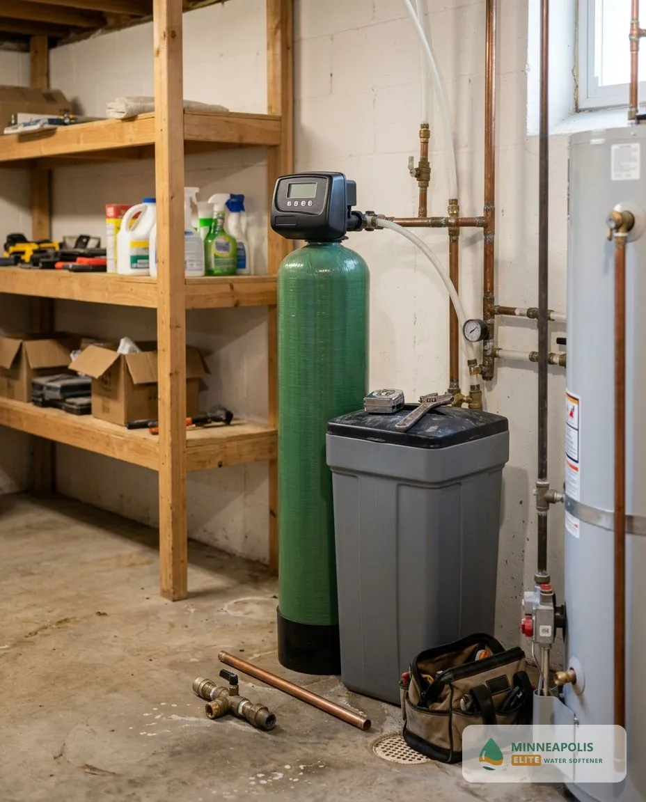

## How Does Water Softener Installation Work in Minneapolis, MN?

Water softener installation follows four steps from the first call to a tested result.

### Step 1: Free Consultation

We talk through your household size, water use and what you notice at the tap, then book a visit at a time that suits you.

### Step 2: Water Testing & System Recommendation

A technician tests your water, measures hardness and recommends a softener size and type, with a written, itemized price.

### Step 3: Professional Installation

A qualified technician installs the system, connects the drain and brine line, programs the control head and tests every tap. A standard install typically takes about 2 to 4 hours.

### Step 4: Ongoing Support & Maintenance

We explain salt refills and settings, check the system at follow-up visits and answer questions after the job is done.

## Frequently Asked Questions About Water Softeners in Minneapolis, MN

Most questions homeowners ask before buying fall into eight areas: water hardness, cost, system choice, timeline, water source, upkeep, permits and where we work.

How hard is Minneapolis water?

The City of Minneapolis 2025 record lists average total hardness of 94 mg/L (about 5.5 gpg), within a range of 80 to 113 mg/L. That is moderately hard, so a softener reduces scale and spotting without having to fight extreme hardness, and a free test shows your exact number.

How much does water softener installation cost in Minneapolis, MN?

Cost depends on system size, type and the plumbing in your home. <mark class="data-gap">[NEEDS DATA: installed price range, from the tenant or a sourced Minnesota report.]</mark> Your free estimate itemizes equipment, installation and any extra plumbing before you approve it.

What is the best water softener for Minneapolis water?

A salt-based softener sized to your hardness reading gives the strongest result, and a smaller unit can be enough at 5 to 7 gpg. Minneapolis water averages 94 mg/L, so the best unit depends on your measured reading and your household size. <mark class="data-gap">[NEEDS DATA: SpringWell affiliate link, salt-based softener recommendation.]</mark> *Disclosure: if you buy through a SpringWell link on this site, the site may earn a commission at no extra cost to you.*

Salt vs. salt-free water softener: what is the difference?

A salt-based softener removes calcium and magnesium by ion exchange and leaves soft water. A salt-free conditioner changes how scale forms but leaves the minerals in the water. Choose salt-based for the strongest result, and salt-free if you want no salt or brine drain and accept a milder effect.

How long does water softener installation take?

A standard installation typically takes about 2 to 4 hours. Plumbing access, drain location and system type can lengthen the visit, and the technician confirms the schedule at your estimate.

Do I need a water softener with Minneapolis city water?

If your tap water tests above about 60 mg/L, a softener reduces scale and spotting, and Minneapolis water averages 94 mg/L. Households with a new water heater, hard-water spotting or dry skin see the benefit most. Private wells in the suburbs need a water test first for iron and sulfur, which affect the softener.

Does a water softener installation need a permit in Minneapolis?

Minnesota plumbing code requires a plumbing permit for many softener installations according to city guidance in the Twin Cities area. <mark class="data-gap">[NEEDS DATA: confirm the Minneapolis permit rule with the City and the Minnesota Department of Labor and Industry.]</mark> Your installer should state who pulls the permit before work starts.

How often does a water softener need maintenance?

Check the salt level monthly and refill it when the tank is below one third full. A technician should inspect the system once a year, clean the brine tank when salt bridges form and check the control head and resin.

What areas do you serve?

We serve Minneapolis and nearby communities in Hennepin County. <mark class="data-gap">[NEEDS DATA: confirm the tenant's service area list.]</mark> The City of Minneapolis lists Columbia Heights, Hilltop, Bloomington, Edina, Crystal, Golden Valley and New Hope among the places its treated water reaches <mark class="data-gap">[VERIFY: Bloomington's own reports describe its own wells, so confirm each suburb's supplier]</mark>. Call to confirm your address.

## Where Do You Install Water Softeners Around Minneapolis, MN?

We install, repair and replace water softeners across Minneapolis, including Linden Hills, Longfellow, Powderhorn Park and the North Loop, and nearby communities in Hennepin County. <mark class="data-gap">[NEEDS DATA: confirm the tenant's service area list before naming more towns.]</mark> Minneapolis city water is the same across these neighbourhoods, so system size depends on household size and the reading at your tap.
