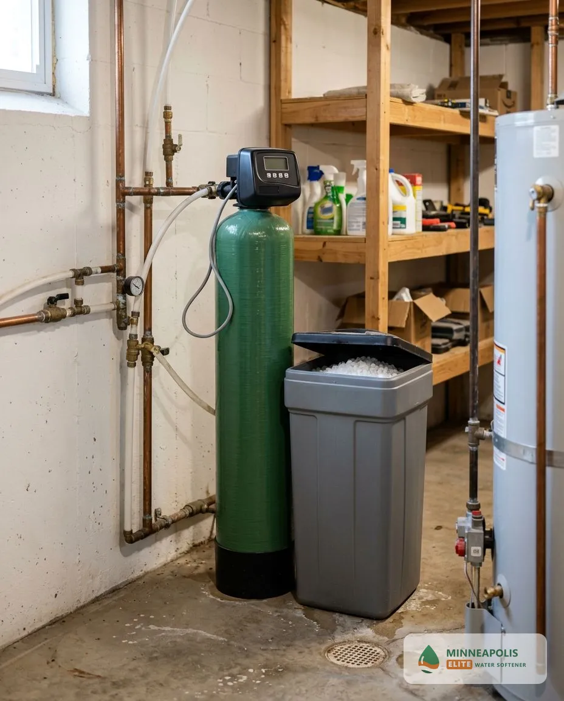
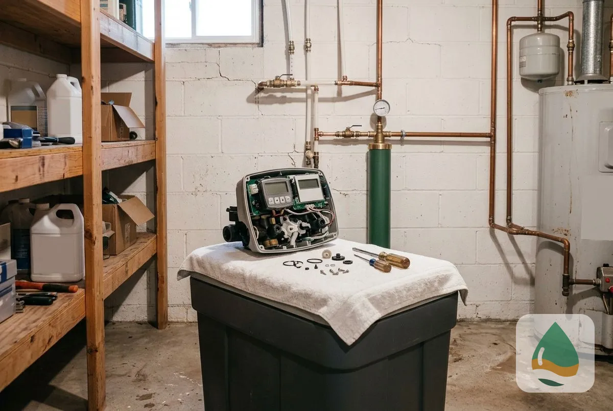
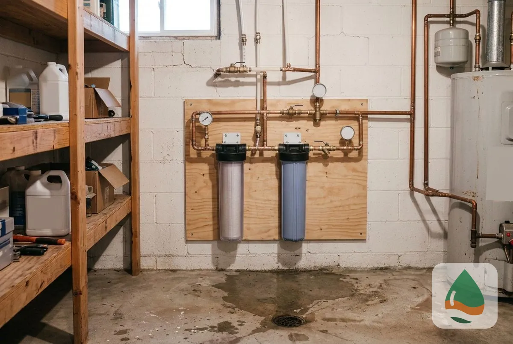
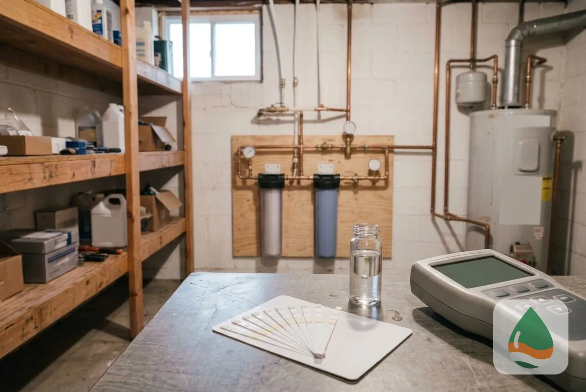
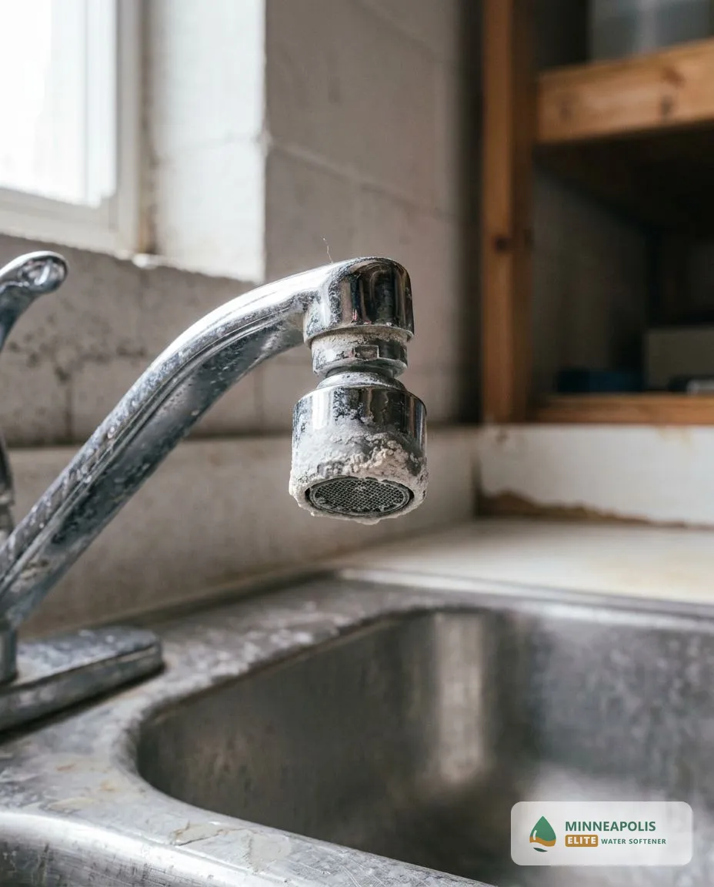

## Why Are We the Best Water Softener Installation Company in Minneapolis, MN?

Homeowners choose a water softener company on five things: who does the work, how the system is backed, how fast help arrives, whether the installer knows local water, and what happens if the result disappoints. These are the questions to put to any installer, this one included.

- **Experience:** <mark class="data-gap">[NEEDS DATA: years in business and installs completed, from the tenant]</mark>. Ask any installer how many systems they have set up in Hennepin County.
- **Warranty:** Your estimate should state the warranty on the equipment and on the labor. Read it before you approve the work.
- **Licensed technicians:** Ask for the installer's Minnesota licence number and proof of insurance before the job. <mark class="data-gap">[NEEDS DATA: Minnesota licence rule and the installer's licence number.]</mark>
- **Local water knowledge:** Minneapolis water comes from the Mississippi River and is softened at the City's plants, so the reading is moderate and varies by month. A good installer sizes the system to your measured hardness, not to a regional guess.
- **Scheduling:** Ask what is open this week. Same-day service depends on technician availability <mark class="data-gap">[NEEDS DATA: tenant confirmation]</mark>.
- **Clear scope and price:** Your free estimate is itemized, so you see what is included before work starts.

[Request Your Free Estimate](#estimate)

## What Water Softener Services Are Available in Minneapolis, MN?

Six services cover most Minneapolis homes, from a first installation to a water test. Each one starts with a free estimate.

### Water Softener Installation

A technician sizes a softener to your household and hardness, then connects it to the main line with a bypass valve, drain line and brine tank. A tested result ends the visit. Most installs finish in one visit.

### Water Softener Replacement

An old unit that no longer softens, leaks or uses too much salt can be replaced with a correctly sized new system. The technician removes the old unit and reconnects the plumbing.

### Salt-Free Water Softener Systems

A salt-free conditioner changes how scale forms and leaves the hardness minerals in the water. It suits homes that want no salt or brine drain, with the limits explained at the estimate.

### Water Softener Repair & Service

Repair covers units that stop regenerating, leak, throw error codes or let hard water through. The technician finds the failed part, such as a valve, motor or injector, and prices the fix before starting.

### Whole House Water Filtration

A whole-house filter removes sediment, chlorine taste and odor at the main line. It pairs with a softener rather than replacing it, because filters do not remove hardness minerals.

### Water Quality Testing

A free hard water test reads hardness in grains per gallon at your tap. The reading sets the system size, and an iron or sulfur result flags a well or a plumbing issue.

## Why Is Minneapolis Water So Hard?

Minneapolis water is moderately hard even after the City softens it at the plant.

### Where Does Minneapolis Water Come From?

According to the City of Minneapolis, the water comes from the Mississippi River, drawn just below the Interstate 694 crossing and treated at the Fridley Water Filtration Plant and the Columbia Heights Ultrafiltration Facility. River water is naturally softer than groundwater, and the City adds a lime softening step at the plant before the water enters the pipes.

### How Hard Is Minneapolis Water?

The City's 2025 record lists average total hardness of 94 mg/L (about 5.5 grains per gallon), with a minimum of 80 mg/L and a maximum of 113 mg/L. Monthly plant results in 2025 ran from 5.1 gpg in March to 6.1 gpg in January. These are readings at the plant, so the number at your tap can differ with your pipes and your neighbourhood.

### How Is Water Hardness Measured?

Hardness is measured in milligrams per liter (mg/L) or grains per gallon (gpg), where 1 gpg equals about 17.1 mg/L. The U.S. Geological Survey rates water under 60 mg/L as soft, 61 to 120 mg/L as moderately hard, 121 to 180 mg/L as hard and anything over 180 mg/L as very hard. By that scale, Minneapolis water at 94 mg/L tests moderately hard.

### What Does Hard Water Do to a Home?

Moderately hard water still leaves marks. Scale builds slowly inside water heaters, dishwashers and washing machines, white spots show on glassware and fixtures, and hard water reacts with soap to form a film that leaves skin dry and hair dull. Homes with older plumbing or a long run of hot water use see the effect sooner.

### How Do You Find Your Exact Hardness?

A free water test shows the exact reading at your tap, because the supply and your home plumbing both move the number. The technician records it in grains per gallon and sizes the softener to that figure.

### How Does a Water Softener Fix Hard Water?

A water softener removes calcium and magnesium through ion exchange and replaces them with sodium or potassium, so scale stops forming and soap lathers properly. For Minneapolis homeowners, that single change protects the water heater and the fixtures at the same time.

