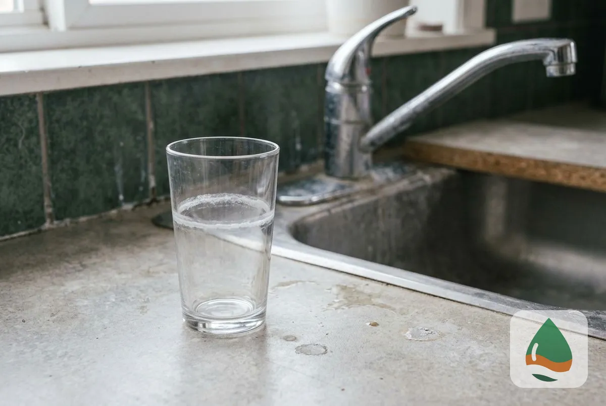
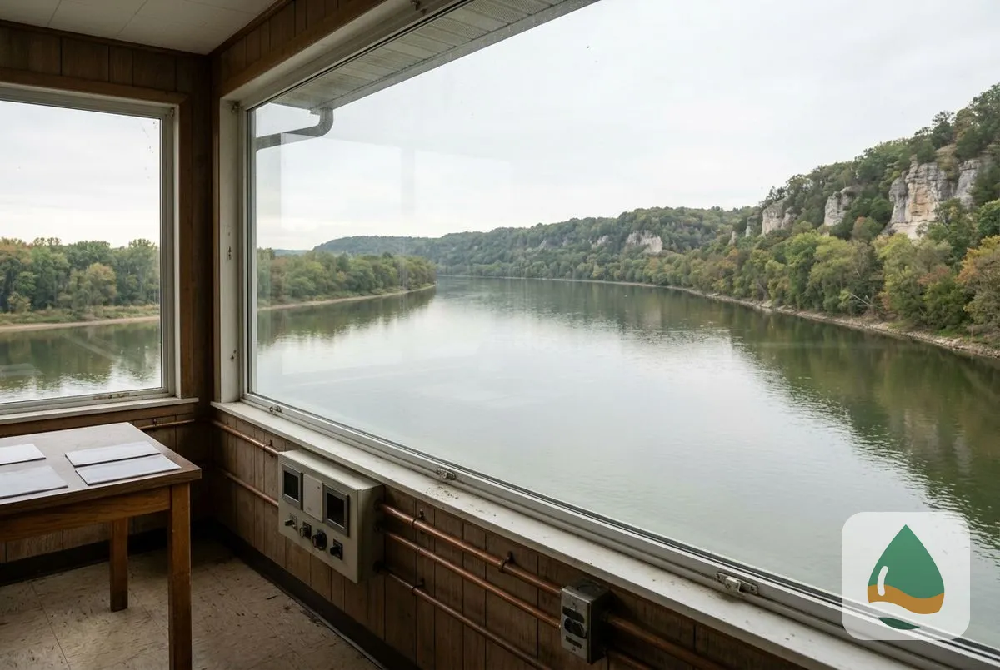
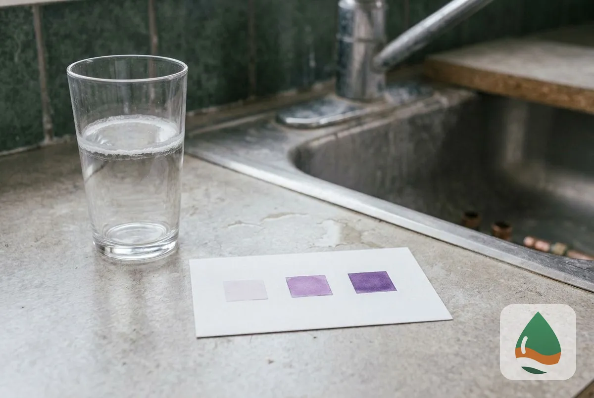

## What Do Minneapolis Homeowners Need to Know About Hard Water?

Three questions cover the basics: what hard water is, why Minneapolis water is hard and how hard it measures.

### What Is Hard Water?

Hard water contains dissolved calcium and magnesium. It is measured in milligrams per liter (mg/L) or grains per gallon (gpg), where 1 gpg equals about 17.1 mg/L. The USGS rates water under 60 mg/L as soft, 61 to 120 mg/L as moderately hard, 121 to 180 mg/L as hard and over 180 mg/L as very hard.

### Why Is Minneapolis Water Hard?

Minneapolis water is moderately hard because the Mississippi River carries calcium and magnesium picked up from limestone and soil in its watershed. The City softens the water with lime at its plants before distribution, which brings the hardness down but does not remove all of it.

### How Hard Is Minneapolis Water?

The City of Minneapolis 2025 record lists total hardness (EDTA method) at an average of 94 mg/L, a minimum of 80 mg/L and a maximum of 113 mg/L, which is 4.7 to 6.6 gpg at 17.1 mg/L per gpg. Monthly plant results in 2025 ran from 5.1 gpg in March to 6.1 gpg in January. These are plant readings, so your tap can differ.

## What Hard Water Does to a Home

Hard water leaves scale in water heaters, dishwashers, washing machines, pipes and fixtures, and it reacts with soap to leave a film on skin, hair and laundry. Scale narrows pipes over time and makes appliances work harder.

## Solutions for Hard Water

A [salt-based](/water-softener-guides/salt-vs-salt-free-water-softener/) water softener removes the hardness minerals, a [salt-free conditioner](/salt-free-water-softener-systems/) changes how scale forms, and a filter does not address hardness. For the strongest result in water above 180 mg/L, a correctly sized salt-based softener is the standard answer. For installation, see [Water Softener Installation in Minneapolis, MN](/water-softener-installation/).

> **Not a good fit if...** your tap tests under 60 mg/L. That water is soft, and a softener adds no benefit.

## How do you test and fix hard water at home?

A free test at your tap gives your reading in grains per gallon, and the technician sizes a system to it. For the test, see [Water Quality Testing in Minneapolis, MN](/water-quality-testing/).

To go further, see [how to size a water softener](/water-softener-guides/water-softener-size-guide/) and [what a water softener costs](/water-softener-guides/water-softener-cost-minneapolis-mn/).

## Frequently Asked Questions

Is Minneapolis water hard?

Yes, moderately. The City of Minneapolis 2025 record lists average total hardness of 94 mg/L, which is moderately hard on the USGS scale, and scale still builds slowly in water heaters and on fixtures.

Is hard water bad for your health?

Hard water is not a health risk in the amounts found in Minneapolis. It affects plumbing, appliances, skin and laundry rather than drinking safety.

Why is my neighbor's water harder than mine?

Plant readings move by month, from 88 mg/L in March to 104 mg/L in January 2025, and the pipes in your home change what reaches the tap. Neighboring homes on the same City supply usually read close, and a test shows yours.

Does boiling remove water hardness?

Boiling precipitates some of the temporary hardness as scale, and it does not make hard water soft. A softener removes the minerals before they reach the pipes.

[Minneapolis Elite Water Softener MN](/) provides water softener installation for homes and businesses across Minneapolis and Hennepin County.

## Get Your Free Estimate

Request a free water softener estimate. We will contact you within 24 hours. [Get a Free Estimate](#estimate) or return to Minneapolis Elite Water Softener for every service we offer.
