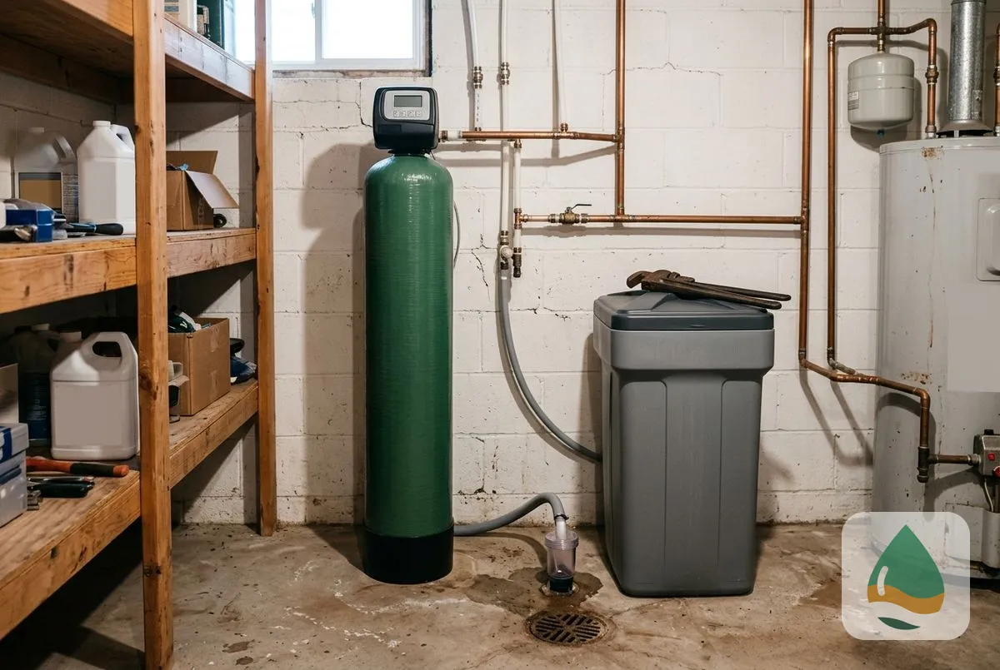
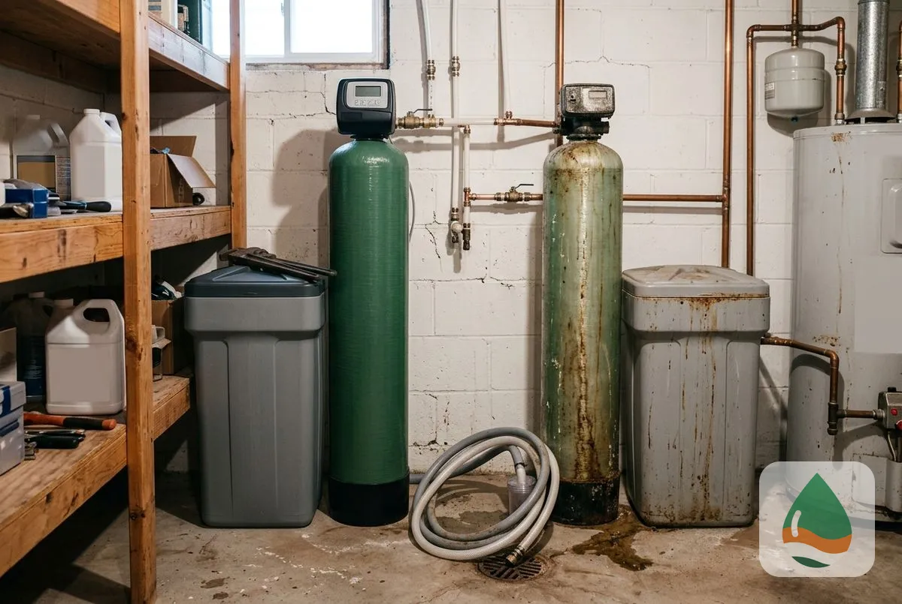
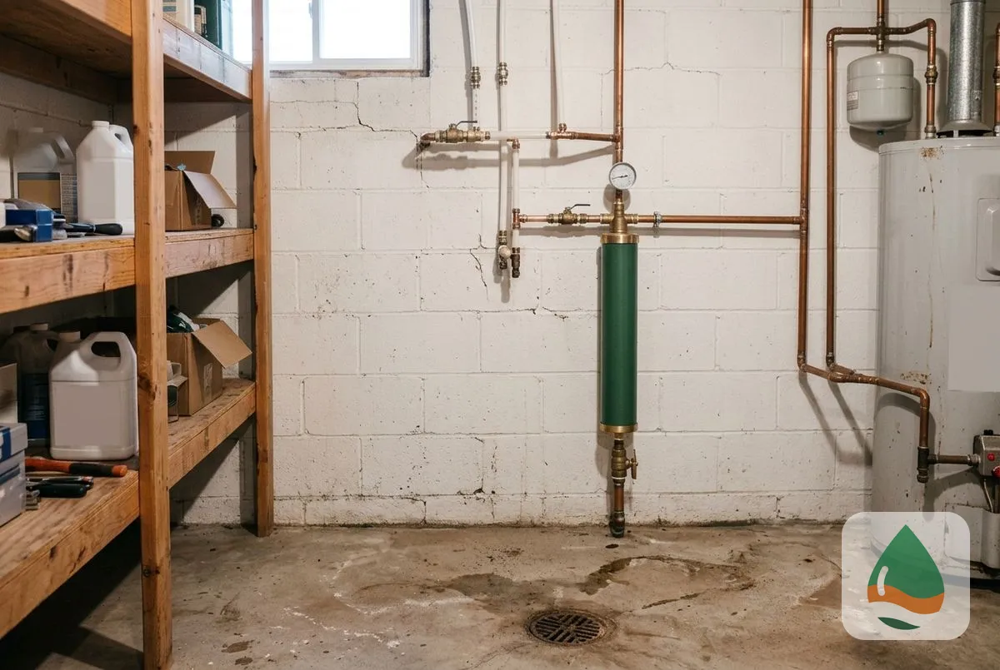

## What Types of Water Softener Systems Are Available in Minneapolis, MN?

This page covers installation, replacement, salt-free systems, dual tank systems, commercial systems, maintenance, repair and water conditioners, starting with why Minneapolis water needs a softener.

### Why Minneapolis Water Needs a Water Softener System

Minneapolis water is moderately hard, so scale builds slowly in water heaters, pipes and fixtures. By the USGS scale, 61 to 120 mg/L is moderately hard, and the City's 94 mg/L average sits inside that band. A softener removes the calcium and magnesium before they reach the plumbing.

### Water Softener Installation

Installation sizes and connects a softener to your main line with a bypass valve, drain line and brine tank. It is the starting point for most homes, and the technician tests hardness first so the unit matches your water.

### Water Softener Replacement

Replacement removes a failing unit and installs a correctly sized new one. It fits leaking tanks, worn control heads and units that no longer keep up with household water use.

### Salt-Free Water Softener Systems

A salt-free conditioner changes how scale forms without removing the hardness minerals. It suits homes that want no salt or brine drain, and the technician explains what it does not do.

### Dual Tank Water Softener Installation

A dual tank softener keeps soft water flowing while one tank regenerates. It suits larger households and light commercial use, where running out of soft water mid-use is a problem.

### Commercial Water Softener Installation

A commercial system is sized to a building's flow rate and peak demand, not to a household. It serves restaurants, car washes, laundries and offices, and protects equipment from scale.

### Water Softener Maintenance

Maintenance keeps a softener at full capacity with salt refills, resin cleaning and a yearly inspection. A larger household needs the check more often.

### Water Softener Repair

Repair finds and fixes valves, motors, injectors and leaks so the unit softens again. The technician prices the repair before starting.

### Water Conditioner Installation

A water conditioner treats scale and hard water without a salt-based exchange. It sits between a salt-free system and a full softener in price and effect.

## Which water softener system fits your home?

Your hardness reading, household size and space decide the system. A free test and estimate settle it in one visit.

## Frequently Asked Questions

What is the difference between a water softener and a water conditioner?

A water softener removes calcium and magnesium by ion exchange, so the water is soft. A water conditioner changes how scale forms and leaves the minerals in the water.

Do I need a softener if my Minneapolis water tests hard?

If your water tests above 120 mg/L, scale builds in the plumbing and appliances, and a softener removes the cause. A free test shows your reading.

How do I choose between salt-based and salt-free?

Choose salt-based for the strongest result. Choose salt-free if you want no salt or brine drain and accept a milder effect.

What size softener does a Minneapolis home need?

Size depends on household size, daily water use and hardness in grains per gallon. The City's plant readings run from 4.7 to 6.6 gpg.

[Minneapolis Elite Water Softener MN](/) provides water softener systems for homes and businesses across Minneapolis and Hennepin County.

## Get Your Free Estimate

Request a free water softener systems estimate. We will contact you within 24 hours. [Get a Free Estimate](#estimate) or return to Minneapolis Elite Water Softener for every service we offer.
