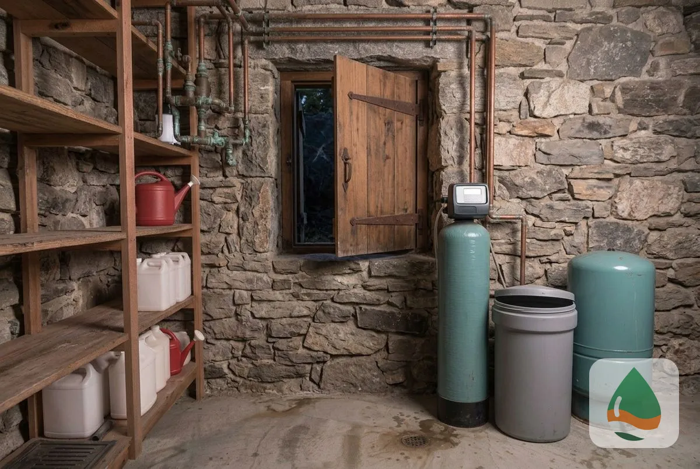
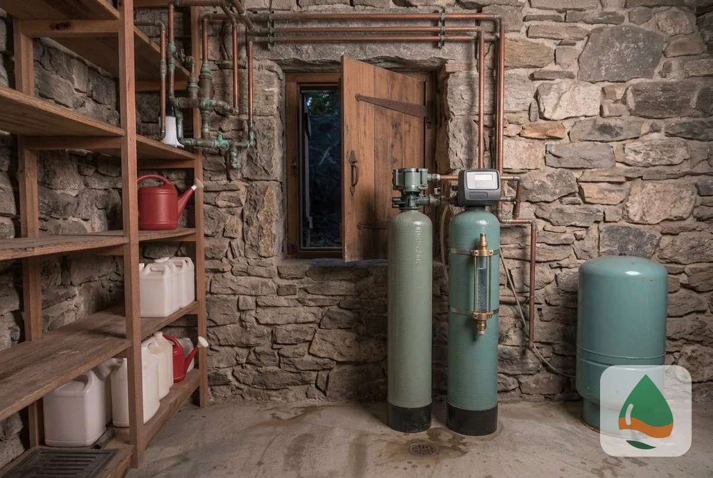
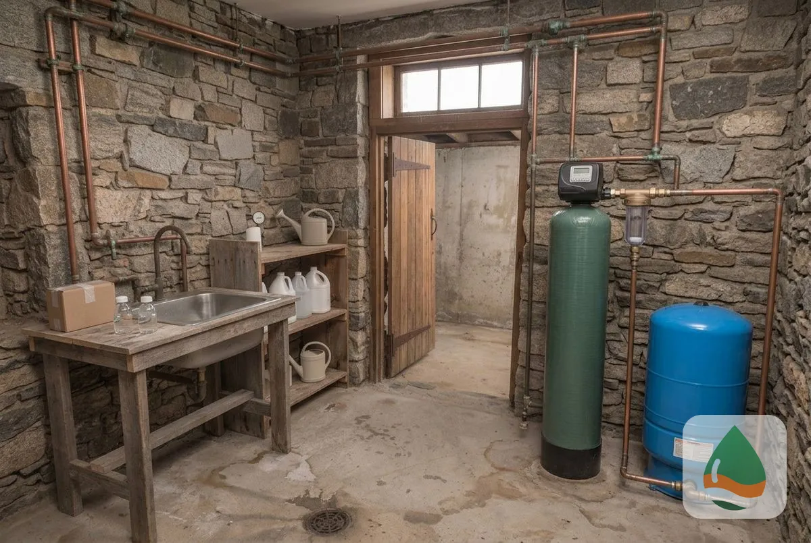
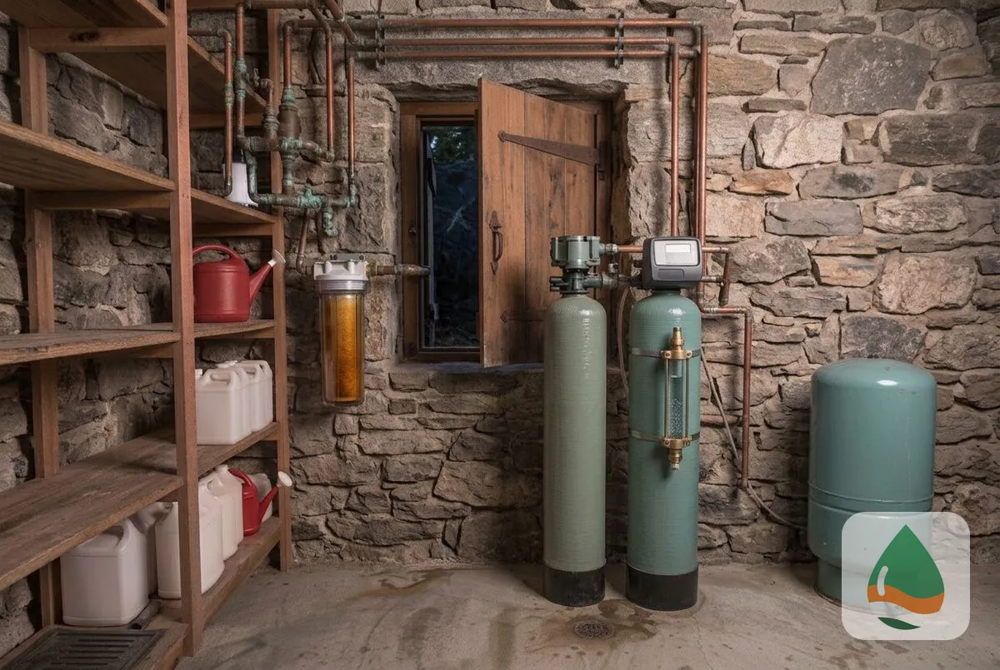
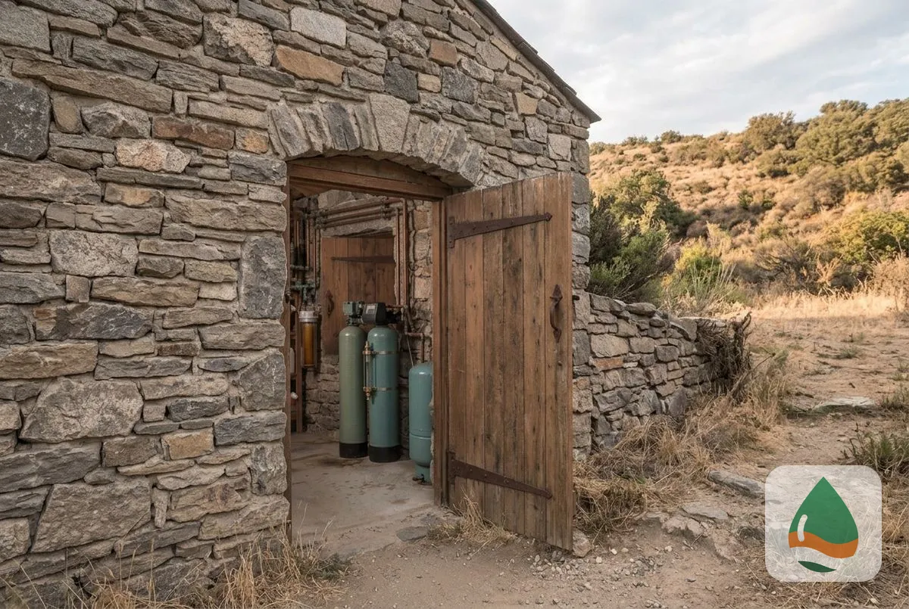

### Well Water Softener Installation

A well water softener installs after the pressure tank and removes calcium and magnesium from the well supply. It is sized from the well's hardness and the household's use, and iron in the water is added to the [sizing](/water-softener-guides/water-softener-size-guide/) figure. A test comes first so the resin is protected.

### Iron Filter Installation

An iron filter removes dissolved and particulate iron before the softener. Iron stains fixtures and laundry and fouls softener resin, so a filter ahead of the softener extends the resin's life.

### Hydrogen Sulfide Filter

A hydrogen sulfide filter removes the rotten-egg smell that sulfur gives well water. A positive sulfur test points to this filter, installed ahead of the softener.

### Well Water Sediment Filter

A sediment filter catches sand and silt that wells can pump, before they reach the softener, fixtures and appliances. The technician matches the micron rating to the test.

### Why Well Water in the Minneapolis Area Needs Special Treatment

Private well water has no utility test, so the owner has to find out what is in it. Groundwater in the Twin Cities metro is typically harder than the City's softened river water <mark class="data-gap">[NEEDS DATA: sourced hardness range for local aquifers]</mark>, which makes a test the only way to know. <mark class="data-gap">[NEEDS DATA: private well conditions in your area.]</mark>

### Well Water Testing

A well [water test](/water-quality-testing/) checks hardness, iron, sulfur, pH, sediment and bacteria. The result decides which filters go in and how the softener is sized. <mark class="data-gap">[VERIFY: cite a recommended private-well testing frequency.]</mark>

> **Not a good fit if...** your well tests soft and clear. A softener adds no benefit, and the technician tells you so.

## What does your well need first?

Your test decides. Start with a free [hard water](/water-softener-guides/hard-water-minneapolis-mn/) test, then add the filters it supports before the softener.

Homeowners comparing options also read about [UV water purification](/uv-water-purification/), [whole-house water filtration](/water-filtration-systems/), [water softener installation](/water-softener-installation/) and [water contaminant removal](/water-contaminant-removal-minneapolis-mn/).

## Frequently Asked Questions

Do I need a water softener on a private well?

If the well tests hard, yes. Well water near Minneapolis can run harder than city water, and a test shows by how much.

What goes first, the filter or the softener?

Filters for iron, sulfur and sediment go before the softener, because they protect the resin.

Why does my well water smell like rotten eggs?

A sulfur smell usually means hydrogen sulfide. A hydrogen sulfide filter removes it.

Does a well water system cost more?

It can, because wells often need filters as well as a softener. <mark class="data-gap">[NEEDS DATA: installed price range from the tenant.]</mark>

[Minneapolis Elite Water Softener MN](/) provides well water softener and treatment for homes and businesses across Minneapolis and Hennepin County.

## Get Your Free Estimate

Request a free well water treatment estimate and test. We will contact you within 24 hours. [Get a Free Estimate](#estimate) or return to Minneapolis Elite Water Softener for every service we offer. For all treatment options, see [Water Treatment Services in Minneapolis, MN](/water-treatment-and-testing/).
